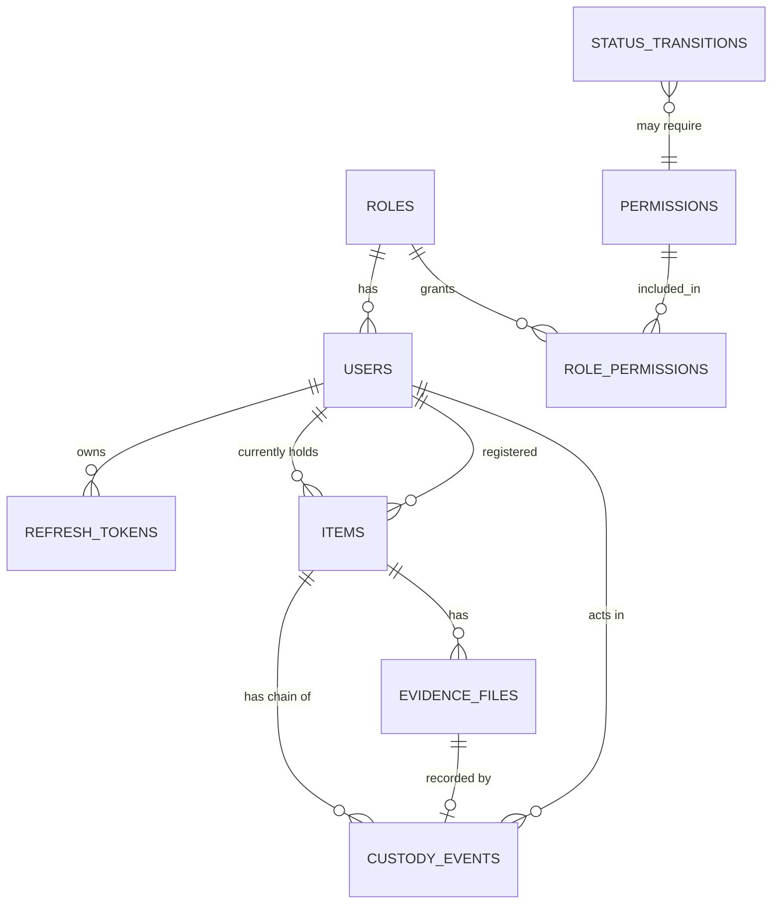

# Chain-of-Custody Vault — Project Specification

> **Source of truth.** If code, README and this file disagree, fix the disagreement here first, then in code.
> Course: CSA406 / CSA409 — Full Stack Development (RESTful Web Services with Node.js + Express.js, React client)
> Rating against the professor's guideline: **Strong** (indexing needs a deliberately inflated seed, same remedy the guideline gives for the Clinic project).
> Spec date: 22 Nov 2026. Time available: **1–2 days** (see Section 17 for the compressed plan and the cut list).

---

## 1. Decisions locked (do not re-debate these)

| Area | Decision | Why (one line, reusable in the viva) |
|---|---|---|
| Relational DB | PostgreSQL | Row locks, partial/composite indexes, `EXPLAIN (ANALYZE)` all behave as the syllabus describes |
| ORM / ODM | Sequelize (SQL), Mongoose (MongoDB) | Sequelize supports `transaction` + row lock (`LOCK.UPDATE`) natively; no raw-SQL escape needed for the core feature |
| Backend | Node.js + Express, one API under `/api/v1` | Syllabus |
| Validation | Zod, via one reusable `validate(schema)` middleware | Typed schemas, one consistent `422` shape |
| Auth | JWT access (15 min) + refresh (7 days, rotated, stored hashed in SQL); bcrypt cost 12 | Rubric |
| Authorisation | Permission-driven RBAC (roles → permissions tables), **plus** an ownership check for custody actions | Rubric says permissions, not role-name strings |
| File storage | `multer` memory storage (10 MB cap) → SHA-256 → stored as `BYTEA` in PostgreSQL | Hosting filesystems are typically ephemeral; storing bytes in the DB survives redeploys and lets file + event commit in one transaction |
| Logging | `pino` + `pino-http`, request ID on every line and in every error body | Rubric |
| Concurrency | Pessimistic row lock (`SELECT … FOR UPDATE`) **and** optimistic `expectedSeq` check | Lock prevents the race; `expectedSeq` turns "you acted on stale data" into a clean `409` |
| Frontend | React + Vite, React Router, Axios, Tailwind, React Context for auth | Section 5 of the guideline |
| Token storage (client) | `localStorage` for both tokens | API and client are on different domains in deployment; cross-site cookies (`SameSite=None`) are fragile. Trade-off (XSS exposure) is documented, see 11.4 |
| Hosting | API: Render or Railway (Docker). PostgreSQL: the host's managed Postgres (or Neon). MongoDB: Atlas free tier. Client: Netlify or Vercel | Guideline asks for Render/Railway for the API |
| Not in scope | Blockchain, digital signatures per event, recipient-acceptance flow, notifications, admin UI for role assignment, QR labels | See Section 3 |

---

## 2. Problem statement

Lab samples, hospital specimens and forensic evidence need a **provable history**: who held the item, when, what state it was in, and proof that none of those records were altered afterwards. Paper logs and ordinary database rows fail the second half of that: anyone with write access can edit a row and nobody can tell.

**The Chain-of-Custody Vault** is a custody tracker for a research lab's samples and evidence files. Every item has exactly one current custodian. Every handover, status change and evidence attachment is recorded as an **append-only event** that stores the hash of the previous event for the same item. Any later edit, deletion or reordering breaks the chain, and a verification endpoint names the first broken link.

**Domain anchor (use this in the report and viva):** a university research lab tracking biological samples and evidence files between collectors and analysts, audited by a lab auditor. Keep it this concrete; do not drift into "generic logistics".

**One-sentence pitch:** *"The server refuses what the interface merely hides, and the history it keeps can prove it has not been rewritten."*

### What makes it non-trivial (not "CRUD with roles")
1. Concurrent handovers of the same item must produce exactly one winner.
2. Records are tamper-**evident**: a verifier recomputes the chain and finds the first break.
3. Authorisation is contextual: a permission **and** being the current custodian.

---

## 3. Scope

### In scope
- Register items (samples / evidence / equipment).
- Hand over custody to another eligible user.
- Change item status through a configured state machine.
- Attach evidence files (hashed on arrival, stored with the chain).
- View an item's full custody timeline, paginated.
- Verify an item's chain (Auditor).
- Access audit log of sensitive actions (Auditor), stored in MongoDB.
- Three roles with different permissions.

### Explicitly out of scope (list these as "future scope" in the report)
- Recipient must accept a handover (two-step handshake).
- Asymmetric signatures per event; external timestamp authority.
- Email / push notifications.
- Admin UI for creating Analysts and Auditors (done by the seed script).
- Multi-lab tenancy, barcode/QR labels, billing, inventory of consumables.

### Honest limitation (state it in the report, do not hide it)
The system is **tamper-evident, not tamper-proof**. Someone with database write access could recompute every hash after editing. Mitigation (P2): store periodic *checkpoint hashes* outside the chain table (Section 12.3), so a rewrite of history no longer matches a checkpoint recorded earlier.

---

## 4. Roles and permissions

Authorisation is driven by **permission codes** loaded from the database, never by comparing role names in route code. Role names exist only as labels in the `roles` table.

| Permission code | Collector | Analyst | Auditor | Meaning |
|---|:-:|:-:|:-:|---|
| `item:create` | ✓ | ✗ | ✗ | Register a new item |
| `item:read` | ✓ | ✓ | ✓ | View items, timelines, evidence metadata, download evidence |
| `custody:transfer` | ✓ | ✓ | ✗ | Hand over an item you hold |
| `custody:receive` | ✓ | ✓ | ✗ | Be eligible to receive custody (Auditors can never hold items) |
| `item:status_change` | ✓ | ✓ | ✗ | Change status of an item you hold |
| `item:dispose` | ✗ | ✓ | ✗ | Move an item to `DISPOSED` |
| `evidence:upload` | ✓ | ✓ | ✗ | Attach evidence to an item you hold |
| `custody:verify` | ✗ | ✗ | ✓ | Run chain verification |
| `audit:read` | ✗ | ✗ | ✓ | Read access logs |
| `checkpoint:read` *(P2)* | ✗ | ✗ | ✓ | Read checkpoint hashes |

**Contextual rule (on top of permissions):** `custody:transfer`, `item:status_change` and `evidence:upload` also require the caller to be the item's **current custodian**. Failing the permission is `403 FORBIDDEN`; failing the custodian check is `403 NOT_CUSTODIAN`.

**Account creation:** `POST /auth/register` creates a **Collector** only. Analyst and Auditor accounts, plus demo credentials, come from the seed script. Role elevation through the API is out of scope.

---

## 5. Domain model (PostgreSQL)

### 5.1 ER diagram



### 5.2 Tables

**`roles`**: `id`, `name` (unique).
**`permissions`**: `id`, `code` (unique).
**`role_permissions`**: `role_id`, `permission_id` (composite primary key).

**`users`**
| Column | Notes |
|---|---|
| `id` | PK |
| `name`, `email` | `email` unique, stored lowercase |
| `password_hash` | bcrypt, cost 12 |
| `role_id` | FK → `roles` |
| `is_active` | boolean, default true |
| `created_at` | |

**`refresh_tokens`**
| Column | Notes |
|---|---|
| `id` | PK |
| `user_id` | FK → `users` |
| `token_hash` | SHA-256 of the token, unique. The raw token is never stored |
| `expires_at`, `revoked_at`, `created_at` | `revoked_at` set on logout and on rotation |

**`items`**
| Column | Notes |
|---|---|
| `id` | PK |
| `item_code` | Unique, human-readable, e.g. `SMP-2026-000123` |
| `name`, `description` | |
| `category` | `SAMPLE` \| `EVIDENCE` \| `EQUIPMENT` |
| `status` | `COLLECTED` \| `IN_TRANSIT` \| `IN_ANALYSIS` \| `STORED` \| `DISPOSED` |
| `current_custodian_id` | FK → `users`. Exactly one holder at all times |
| `head_seq` | Sequence number of the latest event, `CHECK (head_seq >= 1)` |
| `head_hash` | Hash of the latest event (denormalised, updated in the same transaction as each event) |
| `created_by`, `created_at`, `updated_at` | |

**`status_transitions`** *(configuration table, not `if` statements)*
| Column | Notes |
|---|---|
| `from_status`, `to_status` | Composite PK |
| `required_permission` | Nullable FK → `permissions.code`. Example: `DISPOSED` requires `item:dispose` |

Seed rows:

| From | Allowed to | Extra permission |
|---|---|---|
| `COLLECTED` | `IN_TRANSIT`, `STORED` | none |
| `IN_TRANSIT` | `IN_ANALYSIS`, `STORED` | none |
| `IN_ANALYSIS` | `IN_TRANSIT`, `STORED`, `DISPOSED` | `item:dispose` for `DISPOSED` |
| `STORED` | `IN_TRANSIT`, `IN_ANALYSIS`, `DISPOSED` | `item:dispose` for `DISPOSED` |
| `DISPOSED` | none (terminal) | |

**`custody_events`** *(append-only)*
| Column | Notes |
|---|---|
| `id` | PK |
| `item_id` | FK → `items` |
| `seq` | 1, 2, 3, … per item. `UNIQUE (item_id, seq)` is the second line of defence |
| `event_type` | `REGISTERED` \| `TRANSFERRED` \| `STATUS_CHANGED` \| `EVIDENCE_ADDED` |
| `actor_id` | User who performed the action |
| `from_user_id`, `to_user_id` | Custodian before / after. Equal for status changes and evidence; `from_user_id` is null for `REGISTERED` |
| `from_status`, `to_status` | Equal when status does not change; `from_status` null for `REGISTERED` |
| `evidence_id`, `evidence_sha256` | Set only for `EVIDENCE_ADDED` |
| `reason` | Optional free text, max 500 chars, **included in the hash** |
| `occurred_at` | Set by the server inside the transaction, millisecond precision |
| `prev_hash` | `event_hash` of seq−1; 64 zeros for seq 1 |
| `event_hash` | See Section 6 |

**`evidence_files`**
| Column | Notes |
|---|---|
| `id`, `item_id`, `uploaded_by`, `uploaded_at` | |
| `original_name`, `mime_type`, `size_bytes` | |
| `sha256` | Hash of the bytes, computed on arrival |
| `content` | `BYTEA` |

### 5.3 Constraints worth naming in the viva
- `UNIQUE (item_id, seq)`: even if application locking failed, the database refuses two events with the same sequence number.
- `CHECK (head_seq >= 1)`; foreign keys everywhere; `ON DELETE RESTRICT` on custody events (history is never cascaded away).
- *(P2)* A trigger that rejects `UPDATE`/`DELETE` on `custody_events`. The tamper demo then needs the trigger disabled first, which itself makes the point: tampering requires privilege and leaves the chain broken.

---

## 6. The hash chain

### 6.1 Rule (write this once in `lib/hash.js`, used by the API **and** the seed script)

`event_hash = SHA-256( JSON.stringify([ item_id, seq, event_type, actor_id, from_user_id, to_user_id, from_status, to_status, evidence_sha256, reason, occurred_at_iso, prev_hash ]) )`

- Array in a **fixed field order**, so there is no key-ordering ambiguity.
- `null` stays `null`; integers stay numbers; `occurred_at_iso` is UTC ISO-8601 with milliseconds (`2026-11-22T04:48:09.123Z`).
- UTF-8 encoding, output lowercase hex (64 chars).
- Genesis `prev_hash` = 64 zeros.

### 6.2 Verification algorithm (`GET /items/:id/verify`)

Read the item and its events ordered by `seq`. For each event, in order:

1. **Sequence:** `seq` must equal the previous `seq + 1` (starting at 1). Otherwise `SEQ_GAP`.
2. **Linkage:** `prev_hash` must equal the previous event's stored `event_hash`. Otherwise `PREV_HASH_MISMATCH`.
3. **Content:** recomputing the hash from the row's fields must equal the stored `event_hash`. Otherwise `HASH_MISMATCH`.

After the loop: `items.head_seq` and `items.head_hash` must equal the last event's values. Otherwise `HEAD_MISMATCH` (this catches deleted last events).

Response: `{ valid, eventsChecked, firstBrokenSeq?, reason? }`. An invalid chain is a **successful verification with a negative result**, so it returns `200`, not an error.

| Tampering | Caught by |
|---|---|
| Edit any field in an old event | `HASH_MISMATCH` at that seq |
| Delete a middle event | `SEQ_GAP` |
| Delete the last event | `HEAD_MISMATCH` |
| Swap two events | `PREV_HASH_MISMATCH` |
| Edit an event **and** recompute its hash | `PREV_HASH_MISMATCH` at the next event, unless the attacker recomputes the entire remainder (hence checkpoints, P2) |

### 6.3 Why per-item chains
One chain per item means a handover locks only that item's row. A single global chain would serialise every write in the system behind one lock.

---

## 7. The hard subsystem: custody transfer

### 7.1 Request
`POST /api/v1/items/{id}/transfer` with body `{ toUserId, toStatus?, reason?, expectedSeq }`. `expectedSeq` is the `head_seq` the client last saw.

### 7.2 Steps (one transaction, default isolation is sufficient because the lock is taken and values are re-read afterwards)

1. **Before the transaction:** authenticate (`401`), check `custody:transfer` (`403`), validate the body (`422`).
2. `BEGIN`.
3. `SELECT` the item **`FOR UPDATE`**. Missing → `404`.
4. `head_seq ≠ expectedSeq` → **`409 STALE_ITEM`** ("this item changed; reload").
5. Item is `DISPOSED` → `409 ITEM_DISPOSED`.
6. Caller is not `current_custodian_id` → `403 NOT_CUSTODIAN`.
7. Recipient must exist, be active, differ from the caller and hold `custody:receive` → otherwise `422 INVALID_RECIPIENT`.
8. If `toStatus` is given and differs from the current status: look it up in `status_transitions`. No row → `409 INVALID_TRANSITION`. Row needs a permission the caller lacks → `403`.
9. Build the event: `seq = head_seq + 1`, `prev_hash = head_hash`, `occurred_at = now (ms)`, compute `event_hash`.
10. `INSERT` the custody event, then `UPDATE` the item (custodian, status, `head_seq`, `head_hash`).
11. `COMMIT`.
12. **After commit, outside the transaction:** write an entry to the MongoDB access log. A Mongo failure is logged with `pino` but does not fail the request (documented trade-off: availability over audit-log completeness; MongoDB never participates in a transaction).

A unique-constraint violation on `(item_id, seq)` is mapped to `409 STALE_ITEM` as the safety net.

### 7.3 The same pattern, one function
`appendEvent(tx, lockedItem, {eventType, actorId, toUserId, toStatus, evidence?, reason?})` is the **only** code path that writes to `custody_events`. Register, transfer, status change and evidence upload all go through it, so the chain rules live in one place.

### 7.4 Proof (week 8 equivalent, must be captured for the report)
Run `autocannon` (or a short script): **50 concurrent transfers** of the same item, all with the same `expectedSeq`. Expected output: **one `201` and forty-nine `409`**. Then call verify on the item and show `valid: true`. Save the terminal output in `docs/proofs/concurrency.txt`.

---

## 8. API specification

Base path `/api/v1`. JSON everywhere except evidence upload (`multipart/form-data`, field name `file`). Interactive docs at `/api/docs` (Swagger UI, backed by a hand-maintained `openapi.yaml`).

### 8.1 Endpoints

| Method | Path | Permission | Success | Error codes |
|---|---|---|---|---|
| POST | `/auth/register` | public | `201` | `409` email taken, `422`, `429` |
| POST | `/auth/login` | public | `200` tokens + user (+ permissions) | `401`, `422`, `429` |
| POST | `/auth/refresh` | public (refresh token in body) | `200` new pair (rotation) | `401`, `429` |
| POST | `/auth/logout` | authenticated | `204` | `401` |
| GET | `/auth/me` | authenticated | `200` user + permission list | `401` |
| GET | `/users/recipients` | `custody:transfer` | `200` eligible users (query `q`) | `401`, `403` |
| POST | `/items` | `item:create` | `201` + `Location` header | `403`, `422` |
| GET | `/items` | `item:read` | `200` paginated | `401`, `403`, `422` |
| GET | `/items/{id}` | `item:read` | `200` | `404` |
| GET | `/items/{id}/events` | `item:read` | `200` paginated timeline | `404` |
| POST | `/items/{id}/transfer` | `custody:transfer` + custodian | `201` new event | `403`, `404`, `409`, `422` |
| POST | `/items/{id}/status` | `item:status_change` + custodian | `201` new event | `403`, `404`, `409`, `422` |
| POST | `/items/{id}/evidence` | `evidence:upload` + custodian | `201` new event + file metadata | `403`, `404`, `409`, `413`, `415`, `422` |
| GET | `/items/{id}/evidence` | `item:read` | `200` metadata list | `404` |
| GET | `/evidence/{id}/download` | `item:read` | `200` file bytes | `404` |
| GET | `/items/{id}/verify` | `custody:verify` | `200` verification result | `403`, `404` |
| GET | `/audit/access-logs` | `audit:read` | `200` paginated | `403`, `422` |
| GET | `/health` | public | `200` | |
| GET | `/checkpoints` *(P2)* | `checkpoint:read` | `200` | `403` |

**Rule for all three item-changing actions** (`/transfer`, `/status`, `/evidence`): the request carries `expectedSeq` (JSON body, or a form field for the multipart upload) and follows the same lock-and-check order as Section 7.2. Only the transfer body adds `toUserId`; `/status` takes `toStatus` (required) and `reason?`; `/evidence` takes `file` and `reason?`.

### 8.2 List endpoint query parameters (`GET /items`)
`page` (default 1), `pageSize` (default 20, max 100), `status`, `category`, `custodianId`, `mine=true`, `q` (item code prefix or name), `sort` (`created_at` \| `item_code` \| `status`), `order` (`asc` \| `desc`). Unknown or malformed values → `422`.

### 8.3 Response shapes

Paginated lists (the guideline calls out the missing total count as the classic bug):
```json
{ "data": [ ... ], "meta": { "page": 1, "pageSize": 20, "total": 48213, "totalPages": 2411 } }
```

Errors (one shape, produced only by the central error handler):
```json
{ "error": { "code": "STALE_ITEM", "message": "Item changed since you loaded it. Reload and retry.", "details": null, "requestId": "7f3c…" } }
```
Validation errors put per-field messages in `details`.

### 8.4 Status code policy

| Code | Used for |
|---|---|
| `200` | Reads, verification results |
| `201` | Any creation: items, events, users |
| `204` | Logout |
| `401` | Missing, invalid or expired token. Expired access token uses code `TOKEN_EXPIRED` so the client interceptor knows to refresh |
| `403` | Authenticated but lacking the permission, or not the custodian |
| `404` | Missing item / evidence |
| `409` | Stale `expectedSeq`, invalid state transition, disposed item, duplicate email |
| `413` / `415` | File too large / MIME type not allowed |
| `422` | Body, query or path-parameter validation failure |
| `429` | Rate limit on auth routes |
| `500` | Unexpected; generic message, details only in logs |

`PATCH` vs `PUT`: this API has no full-replace resources, so mutations are `POST` actions on an event-producing sub-resource. If a profile edit endpoint is added, use `PATCH` for partial updates and say so in the docs.

---

## 9. MongoDB design

MongoDB never participates in a transaction and only holds data that is append-only or variable-shaped.

| Collection | Document shape | Indexes |
|---|---|---|
| `access_logs` | `{ ts, userId, role, action, itemId?, evidenceId?, ip, requestId, userAgent, outcome }` | `{itemId:1, ts:-1}`, `{userId:1, ts:-1}`, `{ts:-1}` |
| `notes` *(P2)* | `{ itemId, authorId, body, tags[], attributes{free-form: temperature, instrument, reagent…}, createdAt }` | `{itemId:1, createdAt:-1}` |
| `checkpoints` *(P2)* | `{ createdAt, itemCount, rootHash }` | `{createdAt:-1}` |

`action` values: `LOGIN_SUCCESS`, `LOGIN_FAILURE`, `ITEM_VIEWED`, `EVIDENCE_DOWNLOADED`, `VERIFY_RUN`, `PERMISSION_DENIED`.

**The viva sentence:** *"Core entities are in PostgreSQL because they need transactional integrity and referential constraints. Logs are in MongoDB because they are append-only, schema-flexible and high-volume, and they never participate in a transaction."*

---

## 10. Indexes, seed and the `EXPLAIN` demonstration

### 10.1 Indexes and written justifications (these go in the README)

| Index | Justification |
|---|---|
| `users(email)` unique | Login lookup; uniqueness |
| `items(item_code)` unique, plus `text_pattern_ops` for prefix search | Search box (`q`) and uniqueness |
| `items(current_custodian_id, status)` | "My holdings" filter: the most common list query |
| `items(status, created_at DESC)` | Status filter + default sort without a separate sort step |
| `custody_events(item_id, seq)` unique | Reads an item's chain in order; also the concurrency safety net |
| `custody_events(occurred_at)` | Date-range audit queries |
| `custody_events(to_user_id, occurred_at DESC)` | "Everything this person has ever received" |
| `evidence_files(item_id)` | Evidence list per item |
| `refresh_tokens(token_hash)` unique, `(user_id)` | Refresh lookup, revoke-all |

### 10.2 Seed script (`npm run seed`)
- **Target:** 50,000 items and about 500,000 custody events. **Minimum acceptable if time is short:** 20,000 items / 200,000 events.
- Every seeded chain must be **valid**: generate events by calling the same `computeEventHash`, and set each item's `head_seq` / `head_hash` from the last event. Otherwise verify would fail on seeded data.
- Transitions in the seed must follow `status_transitions`.
- About 100 users: three named demo accounts (one per role) with documented demo passwords, the rest sharing **one precomputed bcrypt hash** (computing 100 hashes at cost 12 wastes minutes).
- Bulk insert in batches of about 5,000 rows.
- Timestamps spread over the previous 18 months.

### 10.3 `EXPLAIN` before/after (save outputs in `docs/explain/`)
Create the performance indexes with a **separate script** (`npm run db:indexes`) so the same dataset can be measured both ways. Unique constraints stay in the models.

1. **Holdings query:** `items WHERE current_custodian_id = ? AND status = 'IN_ANALYSIS' ORDER BY created_at DESC LIMIT 20`. Expect `Seq Scan` over 50k rows before, an index scan after.
2. **Date-range query:** `custody_events WHERE to_user_id = ? AND occurred_at BETWEEN ? AND ?`. Expect `Seq Scan` over about 500k rows before, an index scan after.
3. Chain read by `(item_id, seq)` is always indexed by the unique constraint; show its plan once as "after" only.

Use `EXPLAIN (ANALYZE, BUFFERS)` and quote execution time before and after.

---

## 11. Security and cross-cutting concerns

### 11.1 Authentication
- Login returns `{ accessToken, refreshToken, user: { id, name, role, permissions[] } }`.
- Access token: 15 minutes, carries `sub` and `jti`. Permissions are **loaded from the database per request** (or cached briefly), not trusted from the token, so a permission change takes effect immediately.
- Refresh token: 7 days, random 256-bit value. **Rotation:** every refresh revokes the old token and issues a new one. Only the SHA-256 hash is stored.
- *(P2)* Reuse detection: presenting an already-revoked refresh token revokes all of that user's tokens.
- Demo setting: `ACCESS_TOKEN_TTL` configurable through env so the interceptor demo can use 20 seconds.

### 11.2 Passwords and keys
`bcrypt`, cost 12 (env `BCRYPT_ROUNDS`). If native `bcrypt` fails to build in the Docker image, `bcryptjs` is an acceptable fallback; say so in the README.

### 11.3 Middleware (at least two custom ones are required; this project has five)
`requestId` · `authenticate` · `requirePermission(code)` · `validate(schema)` · `errorHandler`. Order: `helmet` → `cors` → `requestId`/logging → body parser → rate limiter (auth routes) → routes → `errorHandler`.

### 11.4 Hardening checklist
- `helmet` defaults; `x-powered-by` disabled.
- `cors`: allowlist from `CORS_ORIGINS` env; no wildcard; allowed methods and headers listed deliberately.
- `express-rate-limit` on `/auth/login`, `/auth/register`, `/auth/refresh` (for example 10 requests per 15 minutes per IP, configurable). A looser global limiter as a backstop.
- **Upload (`multer`):** memory storage, 10 MB limit, MIME allow-list (`application/pdf`, `image/png`, `image/jpeg`, `text/plain`, `text/csv`), one file per request. Return `413` / `415`. *(P2)* Verify magic bytes, since the client-declared MIME type can be spoofed.
- On download, recompute SHA-256 of the stored bytes and compare with `sha256` in the row and in the chain event (cheap integrity check; mismatch → `500 EVIDENCE_CORRUPT` and a log entry).
- **Logging:** `pino` JSON logs; request ID taken from `X-Request-Id` or generated, echoed in the response header and in error bodies; redact `authorization` headers and password fields.
- **Config:** every secret and URL from env; `.env` in `.gitignore`; `.env.example` committed.
- **Token storage trade-off (client):** `localStorage` is readable by any injected script (XSS risk); an `httpOnly` cookie avoids that but adds CSRF handling and cross-site cookie complications when API and client live on different domains. Chosen: `localStorage`, with short access-token lifetime, no `dangerouslySetInnerHTML`, and refresh-token rotation as mitigations.

### 11.5 Environment variables (`.env.example`)

| Variable | Example / default |
|---|---|
| `NODE_ENV` | `development` |
| `PORT` | `4000` |
| `DATABASE_URL` | PostgreSQL connection string |
| `MONGO_URI` | MongoDB connection string |
| `JWT_ACCESS_SECRET`, `JWT_REFRESH_SECRET` | long random strings |
| `ACCESS_TOKEN_TTL` | `15m` |
| `REFRESH_TOKEN_TTL` | `7d` |
| `BCRYPT_ROUNDS` | `12` |
| `CORS_ORIGINS` | comma-separated client origins |
| `MAX_UPLOAD_MB` | `10` |
| `AUTH_RATE_LIMIT_MAX` | `10` |
| `LOG_LEVEL` | `info` |
| `SEED_ITEMS` | `50000` |

---

## 12. Backend structure and build notes

### 12.1 Repository layout
```
custody-vault/
  server/
    src/
      app.js  server.js
      config/            env parsing, constants
      db/
        sequelize.js  mongo.js
        models/          users, roles, permissions, items, custodyEvents, evidenceFiles, ...
        seed/            seed.js, seedReferenceData.js
      middleware/        requestId, authenticate, requirePermission, validate, upload, rateLimiters, errorHandler
      lib/               hash.js, errors.js, logger.js, pagination.js
      modules/           auth/ items/ custody/ evidence/ audit/   (routes, controller, service, schemas)
    scripts/             concurrency.js, tamper-demo.sql, explain.sql
    docs/                openapi.yaml
    postman/             custody-vault.postman_collection.json
    Dockerfile  .env.example
  client/
    src/ api/axios.js  auth/AuthContext.jsx  routes/ProtectedRoute.jsx  pages/  components/
  docs/                  er-diagram.md  explain/  proofs/  report/
  README.md
```
Keep controllers thin: validation in middleware, rules in `services/`, and the transfer logic only in `custody` service via `appendEvent`.

### 12.2 Async errors
Wrap async handlers (or use an async-error helper) so every thrown `AppError(code, status, message)` reaches `errorHandler`. Never send error responses from inside services.

### 12.3 *(P2)* Checkpoints
A `node-cron` job runs daily: build a sorted list of `item_id:head_hash` lines, hash it, store `{createdAt, itemCount, rootHash}` in MongoDB. `GET /checkpoints` lists them. Value: a checkpoint recorded yesterday no longer matches if history is rewritten today.

---

## 13. Frontend specification

Plain, consistent, finished. A correct error state beats an attractive blank screen.

### 13.1 Screens

| Screen | Roles | Contents |
|---|---|---|
| Login / Register | public | Real JWT endpoints; register creates a Collector |
| Items list | all | Filters (status, category, "mine", search), sort, server-side pagination with total pages; loading / error / empty states |
| Item detail | all | Summary, current custodian, status, paginated custody timeline, evidence list, action buttons shown **per permission** |
| Register item | Collector | Form with validation messages from `422` details |
| Transfer dialog | custodian with permission | Recipient picker (from `/users/recipients`), optional new status, optional reason; sends `expectedSeq`; on `409` shows "item changed, reload" and refreshes |
| Evidence upload | custodian with permission | Client-side type/size check, **progress bar** (`onUploadProgress`), server remains the authority |
| Verify chain | Auditor | Button → "Chain valid (N events)" or "Broken at event #K: reason" |
| Access logs | Auditor | Table with filters (item, user, date) and pagination |
| 403 / 404 pages | all | Plain messages |

Navigation and buttons come from `permissions[]` returned by `/auth/me`.

### 13.2 The five pieces that must be built carefully
1. **Token refresh interceptor** (Axios response interceptor): on `401 TOKEN_EXPIRED`, call refresh **once** (single shared in-flight promise); queue other failed requests behind it; retry each with the new token; mark retried requests so they are never retried twice; on refresh failure clear storage and go to login. Never intercept `/auth/login` or `/auth/refresh` themselves.
2. **Token storage decision:** `localStorage`, trade-off written in the README (11.4).
3. **Role-based rendering with the caveat:** hiding a button is a convenience; the server enforces.
4. **Pagination, filtering, sorting** wired to real query parameters and the `meta` block.
5. **Upload with progress**, validated client-side and server-side.

### 13.3 Refuse list (from the guideline)
No animations, dark mode, design system, Redux/Zustand, SSR, charts/dashboards, or pixel-perfect responsiveness. A laptop-usable layout is enough.

### 13.4 Deployment
Separate deployment (Netlify or Vercel). API base URL from `VITE_API_BASE_URL`. Early spike: a single login screen as soon as the auth endpoints exist, to surface CORS and error-shape problems while they are cheap to fix.

---

## 14. The demonstration script (rehearse; about 4 minutes)

1. **The `403` demo.** Log in as the Collector. Point out that "Verify chain" and "Access logs" do not exist in the interface. Copy the JWT from developer tools. In Postman call `GET /items/{id}/verify` with it → `403`. *"The interface hid the button; the server refused the request."*
2. **Concurrency.** Two browser windows, same custodian, both transfer the same item: one succeeds, the other gets `409` with a readable message. Then show the saved `autocannon` output: 50 requests, one `201`, forty-nine `409`.
3. **Tamper detection.** In `psql`, change one field of an old `custody_events` row (disable the trigger first if it exists). As Auditor click **Verify chain** → "Broken at event #K: HASH_MISMATCH". Restore the row, verify again → valid.
4. **Silent refresh.** With `ACCESS_TOKEN_TTL=20s`, wait, click around; show the refresh call and the retried request in the network tab.
5. **Indexing.** Show the two saved `EXPLAIN (ANALYZE)` outputs, before and after.

---

## 15. Likely viva questions (short answers to internalise)

| Question | Answer |
|---|---|
| Why two databases? | The viva sentence in Section 9. The chain needs transactions and constraints; logs are append-only, high-volume and never in a transaction. |
| Is this a blockchain? | No. A per-item hash chain in one database: tamper-**evident**, not tamper-proof. No consensus, no distribution. |
| Could the DBA rewrite history? | Yes, if they recompute every later hash. That is why checkpoints (P2) are stored outside the chain table, and why I call it tamper-evident. |
| Why both `FOR UPDATE` and `expectedSeq`? | The lock makes the check-then-write atomic. `expectedSeq` detects that the caller acted on stale data and gives a clean `409`. The unique `(item_id, seq)` constraint is the last line of defence. |
| Why can't two transfers deadlock? | Each transaction locks exactly one row (the item). No second lock is taken, so there is no lock-ordering cycle. |
| Why not one global chain? | It would serialise every write behind one lock. Per-item chains lock only the item being changed. |
| Why `409` and not `403` for a stale transfer? | The caller is permitted; the **state** conflicts with the request. |
| Why permissions rather than role names? | Roles are just bundles; route code checks capabilities, so adding a role changes data, not code. |
| Why `localStorage`? | Different domains in deployment make cross-site cookies fragile; the XSS trade-off is acknowledged and mitigated by short token life and rotation. |
| Why store files in Postgres? | Hosting disks are typically ephemeral, and the file and its chain event commit together. Trade-off: DB size; fine at 10 MB per file for a lab-scale system. |
| What if MongoDB is down? | Requests still succeed; failures are logged by `pino`. Documented trade-off: availability over audit-log completeness. |
| What would you do with more time? | Recipient acceptance step, per-event signatures, external timestamp anchoring, admin UI. |

---

## 16. Coverage against the professor's checklist

Tick these as they become true in the repository.

### Modules 1–2: REST
- [ ] URL versioning `/api/v1` from the first commit
- [ ] Correct verbs; `POST` actions on event sub-resources; `PATCH` used if any partial update exists
- [ ] `201` on creation, `401` vs `403`, `409`, `422` all demonstrably used
- [ ] Validation on every endpoint (Zod)
- [ ] Central error handler, one error shape with `requestId`
- [ ] At least two custom middleware (five planned)
- [ ] Postman collection committed

### Module 3: Database
- [ ] Normalised schema + ER diagram (Section 5.1 → `docs/er-diagram.md`)
- [ ] Sequelize + Mongoose
- [ ] Every filter/join column indexed, each with a written justification (10.1)
- [ ] `EXPLAIN` before/after saved (10.3)
- [ ] Genuine multi-statement transaction (Section 7)
- [ ] Seed large enough for indexing to matter (10.2)

### Module 4: Middleware, auth, security
- [ ] JWT access + refresh, rotation
- [ ] bcrypt cost 12
- [ ] RBAC from permission tables
- [ ] `multer` with MIME and size validation
- [ ] `pino` with request IDs
- [ ] Env-based config, no secrets in Git
- [ ] `helmet`, deliberate `cors`, rate limit on auth routes

### Module 5: Docs and deployment
- [ ] OpenAPI served by `swagger-ui-express`; every endpoint with request, responses and error codes
- [ ] Git history with meaningful messages (do not backdate commits; if the timeline is compressed, say so)
- [ ] API deployed on Render or Railway
- [ ] Working `Dockerfile`
- [ ] README: setup steps, ER diagram, one architectural decision with its trade-off

### Frontend
- [ ] Vite React app on the deployed API over HTTPS
- [ ] Login/logout on real JWT endpoints
- [ ] Interceptor with single-flight refresh and retry
- [ ] Distinct screens for all three roles, navigation from permissions
- [ ] One list with pagination, filtering, sorting from query parameters
- [ ] Upload with progress
- [ ] Loading, error, empty states everywhere
- [ ] Deployed separately with `VITE_API_BASE_URL`

### Suggested README architectural decision
*"Per-item hash chains protected by a row lock plus an optimistic `expectedSeq` check."* **Trade-off:** it serialises writes to the same item (fine, since one item has one custodian) and gives tamper-evidence rather than tamper-proofing, but it needs no extra infrastructure and keeps the history verifiable by anyone with read access.

---

## 17. Compressed plan: 1–2 days

Hand-coding every item above is more than two days of work. The honest approach is **tiers**. Finish a tier before starting the next; cut from the bottom.

### P0: graded, do not cut
Schema + models + seed reference data · auth (JWT, refresh, bcrypt) · permission RBAC · items + transfer transaction · concurrency proof · evidence upload · access logs in MongoDB · indexes + seed + `EXPLAIN` · helmet/cors/rate limit/pino/env · Swagger · Dockerfile · README · Postman · API deployed.

### P1: expected at demonstration
React login + refresh interceptor · item list with pagination/filter/sort · item detail with transfer, upload progress and verify · loading/error/empty states · client deployed.

### P2: cut first
Checkpoints and cron · append-only DB trigger · refresh-token reuse detection · MongoDB notes · magic-byte check · docker-compose · access-log screen beyond a basic table.

### Day 1: backend to "proven"
| Block | Work | Definition of done |
|---|---|---|
| 1 | Repo, Express skeleton, env, pino, error handler, `/health`, Docker | App boots from `docker run`; `.env.example` committed |
| 2 | Models, reference data (roles, permissions, transitions), ER diagram | Tables created; ER diagram in `docs/` |
| 3 | Auth: register/login/refresh/logout/me, `authenticate`, `requirePermission` | Postman happy and sad paths for each |
| 4 | `lib/hash.js`, `appendEvent`, register item, list/get items, timeline | A registered item has a valid seq-1 event |
| 5 | **Transfer transaction**, status change, `409`/`403`/`422` paths | Postman covers every error branch |
| 6 | `verify` endpoint + `concurrency.js` | Saved output: one `201`, forty-nine `409`; verify valid |
| 7 | First deployment of the API (do this on Day 1 to find hosting problems early) | `/health` reachable over HTTPS |

### Day 2: breadth, then proof, then packaging
| Block | Work | Definition of done |
|---|---|---|
| 8 | Evidence upload/download, MongoDB access logs | Upload rejects wrong type (`415`) and size (`413`) |
| 9 | Seed script, `db:indexes`, `EXPLAIN` before/after | Two plan outputs saved |
| 10 | Security pass, OpenAPI file, Swagger UI | Every endpoint documented |
| 11 | Client: login, interceptor, list, detail, transfer, upload, verify | Whole demo script (Section 14) runs in the browser |
| 12 | Deploy client, final README, Postman export, rehearse demo | Fresh clone follows README successfully |

**Rules for a compressed timeline**
- Commit after every block with a meaningful message. Never backdate.
- The transaction and its proof come before any frontend work.
- If the clock runs short, cut P2 items and screens, never the five frontend pieces in 13.2 and never the proof.
- Rehearse the demo script once end-to-end before the viva.
